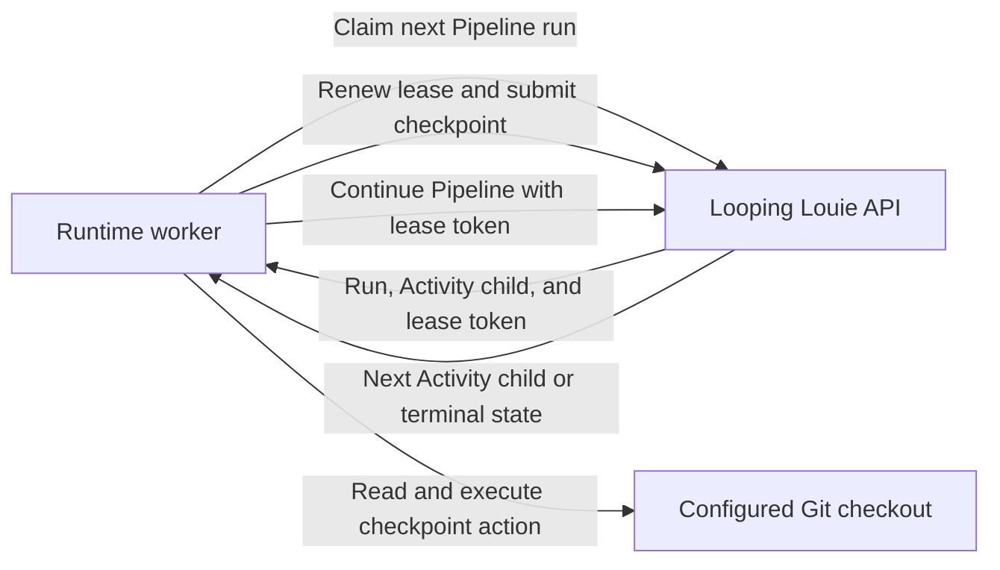

# Looping Louie Architecture

This temporary document describes the architecture of the Looping Louie
product across its repositories. It is not API software architecture. The API
repository's implementation architecture is documented in
[architecture.md](architecture.md).

Looping Louie coordinates iterative LLM-assisted software development. It
persists Pipeline and Activity state in the API while the runtime executes
repository changes in configured local Git checkouts.

The runtime is independent from any programming language, framework, or LLM
provider.

## Worker Provisioning

The API provisions each Project worker identity under the authenticated User.
On initial provisioning, the runtime submits its locally detected Harnesses,
stores the assigned ID in its Project configuration, and reuses it on later
starts. It refreshes the worker heartbeat before polling. PipelineRun claims
require an active worker heartbeat, while the existing PipelineRun lease
continues to authorize only one claimed run. Heartbeat liveness never renews
or revokes a lease.

## Ownership Boundaries

The API owns User and Project resource management, including User-owned
Activity and Pipeline definitions, Project membership, durable Pipeline and
Activity-run state, prompt generation, model decisions, and checkpoint
transitions. Pipeline and Activity definitions are independent of execution
placement; Pipeline and Activity runs remain Project-placed. The runtime owns
Project lifecycle, repository inspection, filesystem changes, Git operations,
and Activity execution after it claims a queued Pipeline run.

The API never mutates the target repository directly, and the runtime does not
make model or reviewer decisions. A claimed runtime worker must present its
active lease token before it checkpoints an Activity child or advances Pipeline
scheduling; the API rejects stale workers before either durable mutation.

## Execution Defaults

User settings persist optional `default_model_id` and `default_harness`
overrides. A missing value explicitly means no User-level default.

User settings also persist model availability policy. Unconfigured logical
models inherit `default_model_availability`, which defaults to `enabled`, and
`configured_models` overrides the status per model ID. Current-User catalog
documents expose this independent policy as top-level `enabled`. Top-level
`available` additionally requires provider readiness and describes whether
`louie` can resolve a User-owned Linked Service for the model.

The hierarchy persists candidates at User, Pipeline, Activity, and loop-agent
scopes. Pipeline and Activity store first-class nullable `model_id` and
`harness` fields; agents store nullable `model_id` in their typed loop
configuration. It is intentionally separate from Personas, which are reusable
instructions rather than model-routing or provider-connection resources.
PipelineRun creation resolves and freezes effective values: agent, Activity,
Pipeline, then User for model IDs; and Activity, Pipeline, then User for
Harnesses.

For `louie`, creation requires an effective model ID and selects the first
deterministically ordered compatible, enabled, configured User-owned Linked
Service before freezing its identity and owner in a private `model_target`
snapshot. `codex_cli` and `copilot_cli` do not select API Linked Services or
require API provider credentials. For each CLI Harness Activity, creation
freezes every agent's effective model as `requested_model`, resolves each
Persona and its ordered Skills from the User-owned library, and freezes their
versioned content in the Activity snapshot delivered through `run_harness`.
A CLI Harness Activity without an effective model ID, with an unknown or
deprecated model, or with a model disabled by User policy fails before the
PipelineRun is persisted. Personas are instruction-only resources. An unset
effective Harness becomes the `louie` v1 compatibility default after
considering the User default. Projects continue to select execution placement
only.

## Harnesses

A Harness is the local execution mechanism for runtime-executable Activities.
It is distinct from an Activity agent: an agent is a generator, reviewer, or
aggregator role backed by a Persona and model selection; a Harness carries out
the Activity in a worker's configured checkout and reports normalized results.

The API-directed repository executor is the `louie` Harness. It collects
repository context, applies API-approved file operations, gathers review input,
and commits only when the API authorizes the handoff. `louie` v1 is the
compatibility default for existing Pipelines.

A Pipeline may select one Harness for its runtime-executable Activities. Human
Activities (`approval` and `quiz`) remain intrinsically human-executed and do
not use the selected Harness. PipelineRun creation freezes the effective
Harness for each Activity, preferring its own override before Pipeline and User
candidates, then using the `louie` v1 compatibility default. A Pipeline edit
must not change the Harness used by an existing run.

Harness definitions use a stable kind, a version, and a kind-specific `config`
object. The implemented `louie` v1 configuration must be empty. The API stores
only policy that it can validate and audit. Worker-local configuration,
including checkout paths, executable locations, credentials, and secrets,
remains outside Pipeline definitions.

```json
{
  "harness": {
    "kind": "louie",
    "version": "v1",
    "config": {}
  }
}
```

Harness kinds retain the same configuration shape. `codex_cli` v1 currently
uses an empty configuration. Its executable, sandbox policy, timeout,
credentials, and other local settings remain Worker-owned:

```json
{
  "harness": {
    "kind": "codex_cli",
    "version": "v1",
    "config": {}
  }
}
```

`codex_cli` supports `direct_loop`, `refinement_loop`, and `roundtable_loop`.
The API owns their shared semantics and persists one `run_harness` checkpoint
per agent turn: writer execution, read-only proposal, read-only review, or
writer aggregation. This lets another Harness adapter implement the same roles
without duplicating loop state or commit policy. It does not replace
API-directed scheduling, lease validation, or commit authorization. Workers
advertise Harness capabilities during registration and replace the currently
observed set on heartbeats. The API requires an exact capability match before a
PipelineRun claim. A valid run remains queued while no active worker advertises
its frozen Harness and may be claimed after a later heartbeat reports that
Harness. Readiness queries compare the next claimable Activity's frozen Harness
with Project-scoped registrations using the same two-minute heartbeat window as
claim admission. They expose only aggregate counts and the latest heartbeat,
not Worker identities or local configuration.

The runtime reports the turn identity, phase, iteration, structured semantic
output, final response, checkout diff, changed files, usage, diagnostics,
requested model, actual model, and optional opaque session reference through
`run_harness`. Normalized observations use a versioned common envelope
identified by `schema_version` and the frozen Harness kind and version;
Harness-specific adapters add only their own fields. The payload includes the
immutable effective model and Persona and Skill snapshot resolved at run
creation, so the runtime does not query mutable resources during execution.
The API rejects a result whose reported Harness differs from the snapshot and
rejects a successful result whose requested model differs from it. For
commit-enabled runs, Codex also proposes a non-empty commit message in its
normalized Harness result. The API persists that proposal and returns it only
when the Activity reaches `commit_if_allowed`, preserving the same
commit-authorization boundary used by the `louie` Harness.

When API-owned generation detects a classified model catalog failure while
processing a valid checkpoint, the API records a terminal failed Activity with
a structured failure reason. It does not leave the claimed Pipeline child
reclaimable after returning the error to the runtime.

Each Pipeline run freezes its `commit_mode` authorization policy. A `forbid`
run completes after approved operations without emitting a commit checkpoint;
the runtime's local Git policy may further deny an allowed commit but cannot
grant one forbidden by the persisted run policy.

Pipeline runs preserve an append-only event ledger. It records run creation,
each worker claim, step start and terminal state, and the complete normalized
Harness turn observation. The generic `harness_turn_completed` and
`harness_turn_failed` event names describe the common outcome; consumers
identify the concrete implementation by its embedded Harness.

A ready `approval` or `quiz` Activity creates a normal child Activity run with
a human executor and transitions the Pipeline to `waiting` without assigning a
worker lease. Users submit its decision through the Activity-run continuation
API. A rejected human Activity run resets frozen predecessor steps for
corrective execution; the scheduler creates a new human child after those steps
complete again.

## Execution Flow



The worker polls at most one run per configured project per cycle. The runtime
retries operational failures after the configured delay without preventing
other Projects from being polled. Unexpected errors stop the process.
